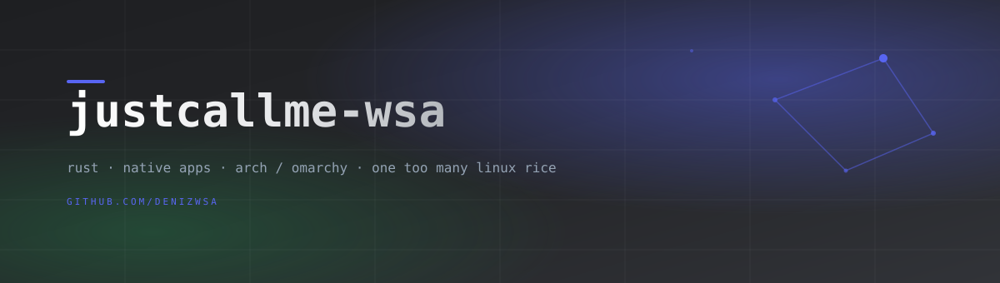

<div align="center">



<a href="https://wsamiawclient.lol"></a>
&nbsp;

&nbsp;

&nbsp;


<br/>

[**about**](#-who-are-you-again) &nbsp;·&nbsp; [**stack**](#-stack) &nbsp;·&nbsp; [**projects**](#-current-orbit) &nbsp;·&nbsp; [**stats**](#-stats) &nbsp;·&nbsp; [**now**](#-current-nonsense) &nbsp;·&nbsp; [**contact**](#-reach-me)


</div>

## 💥 who are you again?

I'm **Deniz — "Justcallme-wsa"**. `@Denizwsa` here, `denizkwsa` everywhere else.

I write native software, mostly in Rust, occasionally in C++ when the build system is feeling confident. I tear things apart, rebuild them smaller, then convince the README to make it look intentional. Linux (Arch/Omarchy) daily driver, Wayland only.

- 🪽 **[Drift](https://github.com/Denizwsa/drift)** — a native Discord client in Rust. No Electron. No excuses.
- 🎮 **[Liquidwsa](https://github.com/Denizwsa/Liquidwsa)** — free Minecraft hacked client (utility mod, Fabric).
- 🖌️ **[wsarndr](https://github.com/Denizwsa/wsarndr)** — 2D vector renderer, Rust + Vulkan + JNI.
- 🌳 **[omarchy-superlig](https://github.com/Denizwsa/omarchy-superlig)** — Omarchy bar plugin: Maçkolik football.

## 🛠️ stack

<p>
  
  
  
  
  
  
  
  
  
  
</p>

## 🧠 how I build

- native first. Electron is a suggestion, not a lifestyle.
- small commits or it didn't happen.
- if the machine can't run it, it wasn't built.
- RE the thing, don't ask the thing.

## 🚀 current orbit

<table>
<tr><td>

**🪽 Drift** — Discord in pure Rust
<sub>gateway + REST reverse-engineered, native rendering, QR/2FA login, no Chromium tax.</sub>

```
text / DMs / servers / live-stream previews
email + QR + TOTP login · voice protocol (WIP)
```

</td><td>

**🖌️ wsarndr** — Vulkan, no excuses
<sub>standalone 2D vector renderer, embeddable, JNI bridge.</sub>

```
embedded in apps · no GPU driver drama (mostly)
```

</td></tr>
</table>

## 📊 stats

<div align="center">
<table>
<tr>
<td></td>
<td></td>
</tr>
<tr>
<td align="center"></td>
<td align="center"></td>
</tr>
</table>
</div>

<div align="center">

</div>

<div align="center">
<a href="https://github.com/Denizwsa/drift"></a>&nbsp;
<a href="https://github.com/Denizwsa/wsarndr"></a>
</div>

## 🧠 current nonsense

- making **Discord native** because Electron on a low-RAM box is a hate crime
- porting **Minecraft 26.3** mods (`wsamiaw-recode`) — every crash signature documented
- writing a **Vulkan** renderer **pure** in Rust, JNI and all
- Omarchy desktop: frame-sized Hyprland bars, football widgets, nobody asked

## 📬 reach me

<div align="center">

[](https://wsamiawclient.lol)


</div>


